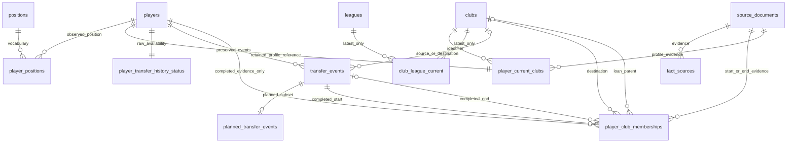

# Final v3 logical relational schema

CSV empty cells are null; identifiers remain TEXT. Keys are logical and independently validated. Original player, club, and competition identifiers are unchanged. Temporal status is separate from fee/event and membership classification.

| Table | Primary key | Foreign keys |
|---|---|---|
| players | player_id | current_club_id → clubs.club_id |
| positions | position_id | None |
| player_positions | (player_id, position_id) | player_id → players.player_id; position_id → positions.position_id |
| clubs | club_id | current_domestic_competition_id → leagues.league_id (nullable) |
| leagues | league_id | country_id refers to an upstream country identifier; no countries table is released. |
| club_league_current | (club_id, league_id); club_id also unique in this snapshot | club_id → clubs.club_id; league_id → leagues.league_id |
| transfer_events | transfer_event_id | player_id → players.player_id; from_club_id/to_club_id → clubs.club_id (nullable); raw_source_id → source_documents.source_id (nullable) |
| player_club_memberships | membership_id | player_id → players.player_id; club_id/parent_club_id → clubs.club_id; source_transfer_event_id/end_source_transfer_event_id → transfer_events.transfer_event_id; source_id/end_source_id → source_documents.source_id (parent/end fields nullable) |
| player_current_clubs | current_relation_id; player_id also unique | player_id → players.player_id; club_id → clubs.club_id; source_id → source_documents.source_id |
| player_transfer_history_status | player_id | player_id → players.player_id |
| source_documents | source_id | None |
| fact_sources | (entity_type, entity_id, fact_name, source_id) | source_id → source_documents.source_id; entity_type/entity_id form a validated polymorphic reference (see schema.md) |
| planned_transfer_events | transfer_event_id | transfer_event_id → transfer_events; player_id → players; raw_source_id → source_documents |

fact_sources uses the unique composite key (entity_type, entity_id, fact_name, source_id); a null source_id is permitted only when provenance_status=unresolved. In this release every source_id is non-null and resolved. Entity types map to player/player_id, position/position_id, club/club_id, league/league_id, transfer_event/transfer_event_id, planned_transfer_event/transfer_event_id, player_club_membership/membership_id, player_current_club/current_relation_id, player_transfer_history_status/player_id. Association IDs use player_position=player_id:position_id and club_league_current=club_id:league_id. Polymorphic references are independently validated.

Historical membership source_transfer_event_id and optional end_source_transfer_event_id must reference completed, uniquely raw-matched events. The latter date is exact, strictly later, and no later than the release date. Planned observations remain in transfer_events and planned_transfer_events, and never participate in historical starts, ends, or ambiguity resolution. Unknown temporal evidence does not support historical membership. Membership source_id/end_source_id resolve to the corresponding raw source records.

players.current_club_id and player_current_clubs.club_id reference the same retained profile identifier; current-relation dates remain null. Special-status references do not become normal club memberships. club_league_current and clubs.current_domestic_competition_id describe latest retained leagues, never historical leagues. leagues.country_id refers to upstream countries (not a released table). raw_event_id refers to the preserved intermediate enrichment.

Every retained source raw_locator must resolve to an existing file, DuckDB row, or JSON/JSONL record/pointer. URL-only sources, if present, must retain legitimate original URL references rather than manufactured locators. Missing raw-club evidence is quarantined outside the canonical database. fact_sources.provenance_status prevents unsupported facts from being advertised as resolved. Provenance completeness is measured from actual valid evidence, not just source-ID presence.

Use [data_dictionary.csv](data_dictionary.csv) for all columns, logical types, nullable permissions, provenance notes, and [README.md](README.md) for table limitations.
