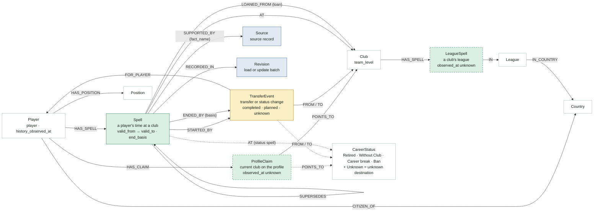

# Football temporal KG schema (v3)

A KG design that stores player–club–league memberships with validity intervals, sources and versions, so that the membership at any date can be queried and new information can be added without a rebuild. All numbers were counted directly from the `dataset/` final_v3 release (2026-10-08) on 2026-10-11. v3 adds per-player observation horizons, the inference rule R3 and the evaluation protocol, following review feedback (§15).

- **Read it with the implementation:** [docs/model.md](docs/model.md) describes the KG as built (r0), and where it is more precise than this document, its "Clarifications of kg-schema v3" take precedence. The actual behaviour of the update operations is in [docs/updates.md](docs/updates.md), and the recomputed numbers are in the validation report (`build/r0/reports/validation_report.md`, also in a release's Parquet zip).
  - These expressions in this document changed in the implementation: `Club:Unresolved` → the separate label `UnresolvedClub`; Spell's `derivation` → `origin`, `end_derivation` and `evidence_end_method`; §8 warning 4's 4,338 players → 4,443 under the v3 definition; §12's "at most A_max" → "under A_max"; §13's 625 players → 626.
  - Sentences that disagreed with the implementation were corrected on 2026-10-14 (§15).
- Visual version: <https://claude.ai/artifact/FfgXGum42D8XLPUD3QHceQ>
  - It reflects v2, so per-player observation horizons and R3 are not in it yet.
  - It is a private link; others can open it only after it is shared with them.
- Data description: [dataset-description.md](dataset-description.md) · column definitions: [dataset/data_dictionary.csv](dataset/data_dictionary.csv)
- This document replaces the KG proposal in `dataset-description.md` §7. It differs from that proposal in three ways:
  - Relationships become nodes instead of Fact nodes.
  - `ProfileClaim` replaces `CURRENTLY_PLAYS_FOR`.
  - Each player has an observation horizon.

## 1. Goals and design principles

| Goal | How the schema meets it |
|---|---|
| Store player–club–league relationships with validity intervals and sources, and query the membership at any date | Relationships become nodes (`Spell`, `LeagueSpell`, `ProfileClaim`), so intervals and sources attach to them directly. The as-of rules (§6) return the answer and its certainty grade |
| Add new information without a rebuild, through integrity constraints, update operations and conflict-resolution rules | Intervals are derived from events (§5), and updates add new versions instead of overwriting (`Revision`, `SUPERSEDES`). The rules are in §8–§10 |
| Show the improvement over closed-book and document RAG with date-specific QA | The answer grades and the per-player observation horizons set the scope of the gold set, and `Revision` reproduces the KG of a given point in time (§12) |

There are five design principles.

1. **Relationships are nodes.** A player's membership (`Spell`), a club's league (`LeagueSpell`) and the club on a profile (`ProfileClaim`) are nodes. Validity intervals, sources and versions attach to the relationship itself, so `SUPPORTED_BY {fact_name}` edges are enough, with no Fact nodes for provenance (about 1.42 million).
2. **Intervals come from events.** The start and the end of a `Spell` point to `TransferEvent`s. The basis of the end is stored as `evidence`, `inferred` or `open`.
3. **There are two time axes.** Valid time is the period in which something was actually true; transaction time is the `Revision` in which the KG learned it.
4. **What the KG knows ends at a different date for each player.** Player histories were collected at different times for each source file (July 2024 to October 2026). After a player's observation horizon `history_observed_at` (H_p), the KG treats the player as unknown.
5. **Answers carry a certainty.** An as-of query returns the club together with one of `CONFIRMED`, `INFERRED`, `OPEN` or `NONE`, and an `INFERRED` answer names its rule (R1, R2 or R3). Planned events do not change spells, but once their date has passed they lower the answer to `OPEN`.

## 2. Overall structure



There are three paths from a player to a club.

| Path | What it holds | The question it answers |
|---|---|---|
| `Player → ProfileClaim → Club` | an undated profile record | weak evidence for "where now?" |
| `TransferEvent → Player`, `TransferEvent → Club` | a change at one date | "when did what change?" |
| `Player → Spell → Club` | an interval | "where did the player play on date t?" |

As-of queries are answered from `Spell`; the other two paths provide the basis (events) and supporting evidence (profiles). `SUPPORTED_BY`, `RECORDED_IN` and `SUPERSEDES` are drawn only on Spell in the diagram, but the other versioned nodes (§3.1) have them too.

## 3. Nodes

| Node | Meaning | Main properties | Key | Count (final_v3) |
|---|---|---|---|---:|
| `Player` | player | `name`, `birth_date`, `birth_date_precision` (exact · year · unknown), `birth_city`, `birth_country`, `history_coverage` (valid_nonempty · valid_empty · unavailable), `history_source`, `history_observed_at`, `history_complete` | `player_id` | 40,706 |
| `Club` | real club | `name`, `name_scope`, `aliases[]` (observed_names), `team_level` (first_team · reserve · youth, derived) | `club_id` | 13,599 |
| `Club:Unresolved` | club ID without a name | none | `club_id` | 9 |
| `CareerStatus` | a status that is not a club | `code`: retired · without_club · career_break · ban · unknown_destination | `club_id` (123, 515, 2113, 2077, 75) | 4 + 1 |
| `League` | league | `name`, `competition_type`, `competition_sub_type`, `metadata_status` | `league_id` | 32 |
| `Country` | citizenship and league country (derived) | `name`, `aliases` (Turkey · Türkiye), `fifa_rank` | `name` | 53 |
| `Position` | position | `position`, `sub_position` | `position_id` | 13 |
| `ProfileClaim` | current club on the profile (snapshot) | `relation_kind`, `observed_at` (unknown), `stale` | `current_relation_id` + `version` | 40,706 |
| `TransferEvent` | transfer or status change | `date`, `order_in_day`, `season`, `event_type`, `temporal_status` (completed · planned · unknown · cancelled), `raw_match_status`, `transfer_id`, `fee_raw`, `fee_eur`, `classification_rule` | `transfer_event_id` + `version` | 137,776 |
| `Spell` | a player's time at a club | `type` (permanent · loan · unknown · status), `valid_from`, `valid_to`, `end_basis`, `derivation`, `last_confirmed_at`, `transit`, `confidence_status` | `spell_id` + `version` | 110,621 + 2,758 derived |
| `LeagueSpell` | a club's league (snapshot) | `valid_from`, `valid_to`, `observed_at` (all unknown), `basis = snapshot` | `club_id:league_id` + `version` | 796 |
| `Source` | source record | `source_type`, `url`, `raw_locator`, `retrieved_at`, `content_sha256`, `extraction_method` | `source_id` | 365,128 |
| `Revision` | load or update batch | `recorded_at`, `source_as_of`, `origin`, input hashes, row counts | `revision_id` | r0 = final_v3 |

- `history_source`, `history_observed_at` and `history_complete` are defined in §5.2.
- `CareerStatus` Unknown (75) is not a career status. Of the 205 completed events to this ID, 104 are free transfers, so it is treated as an "unknown destination".
- `Spell.type = unknown` takes the dataset's `membership_type` as given: a membership whose type is not confirmed, such as a paid transfer or a move without a label. It is a different concept from an unknown destination (`unknown_destination`).
- `TransferEvent.order_in_day` is the order of events on the same day (§5.1).
- `Club.team_level` is a property derived from name patterns.
  - A provisional pattern (age markers such as U19 and U21, II, B, Yth, Youth, Juvenil, Primavera, Reserves, Jong, Academy, Sub-20) marks 5,296 club IDs, 26.3% of the membership spells, as youth or reserve.
  - Some reserve teams escape the pattern, such as "RM Castilla", "Juve Next Gen" and "Barça Atlètic".
  - The pattern is finalized after checking precision and recall on 100 matched and 100 unmatched names. The links to first-team clubs used in scoring (for example Club Brugge U18 → Club Brugge) are decided at the same time. This check has not been done for r0, and the pattern is provisional (`team_level_basis = provisional_name_pattern_v0`).
- Entity properties (Player, Club, League and so on) are updated in place, and changed values are logged in the `Revision`. Queries over property history are out of scope.

### 3.1 Common properties of versioned nodes

`Spell`, `TransferEvent`, `ProfileClaim` and `LeagueSpell` all carry the following.

- `version`: counts up from 1 within a logical ID.
- `tx_from`, `tx_to`: the interval in which this version is recorded in the KG. An empty `tx_to` means the current version. They copy the information of the `RECORDED_IN` and `SUPERSEDES` edges to make filtering fast.
- `RECORDED_IN → Revision`: the batch that created this version.
- `SUPERSEDES → previous version`: absent on the first version.

## 4. Relationships

| Relationship | From → to | Count | Properties | Notes |
|---|---|---|---|---|
| `HAS_CLAIM` | Player → ProfileClaim | 1 current version | | |
| `POINTS_TO` | ProfileClaim → Club · CareerStatus · Club:Unresolved | 1 | | Club 40,679 · Unresolved 21 · CareerStatus 6 |
| `FOR_PLAYER` | TransferEvent → Player | 1 | | |
| `FROM`, `TO` | TransferEvent → Club · CareerStatus | 1 each | | special IDs: FROM 2,444, TO 3,326 |
| `HAS_SPELL` | Player → Spell | 0..n | | |
| `AT` | Spell → Club (CareerStatus for status spells) | 1 | | never an Unresolved ID |
| `LOANED_FROM` | Spell (loan) → Club | 0..1 | | absent for the 3 loans whose parent club is a special ID |
| `STARTED_BY` | Spell → TransferEvent | 1 | | |
| `ENDED_BY` | Spell → TransferEvent | 0..1 | `basis`, `derivation` | absent when open. For an R2 end it points to the next spell's start event |
| `HAS_SPELL` | Club → LeagueSpell | 0..n | | same name as the Player `HAS_SPELL`, so name the labels in queries |
| `IN` | LeagueSpell → League | 1 | | |
| `HAS_POSITION` | Player → Position | 0..1 | | no time |
| `CITIZEN_OF` | Player → Country | 1 | | primary citizenship only |
| `IN_COUNTRY` | League → Country | 1 | | |
| `SUPPORTED_BY` | every node except Country and Revision → Source | 1..n | `fact_name`, `derivation` | §7 |
| `RECORDED_IN` | versioned node → Revision | 1 | | |
| `SUPERSEDES` | new version → previous version | 0..1 | | |

## 5. Time model

### 5.1 Valid time

- Intervals are half-open: `[valid_from, valid_to)`. On a transfer day, the new spell covers the date, not the previous one.
- **Same-day order:** events on the same day are ordered by the pointer index of the raw response (`/transfers/N` in `raw_event_locator`), stored in `order_in_day`.
  - The API response lists transfers newest first, so a smaller index means a later event. There was no exception among 119,211 pairs of consecutive events on different dates.
  - In the rules below, "later" compares (date, same-day order).
- **Zero-length spells:** a spell that the player joins and leaves on the same day becomes a `transit` spell with `valid_from = valid_to`. There are 30 (29 memberships, 1 status spell). They only link the event chain and are never an as-of answer.
- `end_basis` gives the basis of the end.

| `end_basis` | Meaning | 110,621 dataset memberships | 2,758 derived status spells |
|---|---|---:|---:|
| `evidence` | an end recorded in the data (a loan return, or a departure by free transfer, without club, retired or career break) | 45,403 | 0 |
| `inferred` (R1) | end inferred from leaving the same club | 45,422 | 2,123 |
| `inferred` (R2) | end inferred from the start of the next spell | 7 | 1 |
| `open` | no basis for an end | 19,789 | 634 |

The inference rules R1 and R2 store the end date. When both apply, the earlier one is used. The dataset `end_date` is never changed, and `derivation` records the rule name.

- **R1 (leaving the same club):** the date of the earliest completed event leaving the same club. Registration spells (permanent, unknown) ignore loan-outs, because sending a player on loan keeps the registration.
- **R2 (next spell starts):** a loan or status spell ends when the same player's next spell starts.

The other derivation rules are:

- **Status spells:** every completed event whose `TO` is a special ID creates one spell (`type = status`, `AT → CareerStatus`): 2,553 statuses and 205 unknown destinations.
- **`last_confirmed_at`:** the latest date that shows the registration was alive while the registration spell was open. There are two kinds of evidence:
  - the date of a loan-out from the same club: 10,629 spells.
  - the date of a return that the dataset matched as the end of a loan spell (`evidence`): 9,294 spells.
  - The 276 unmatched loan returns are cases the dataset already flags as problems, so they are left out of the evidence and sent to the verification sample (§12).
  - The period a return confirms is mostly one that the loan spell already answers. So the grade of the playing-for answer changes for only a few players per date; mostly the confirmed interval of the registered club grows.
- **R3 (continuation within the observation window):** the rule that an open spell continued up to the player's observation horizon. It depends on lag and A_max, so it is not stored but computed at query time (§6.3).

### 5.2 Observation horizon

A player's history comes from one canonical response (`history_source` = the dataset's `player_transfer_history_status.raw_source_file`), and each source was collected at a different time. Completed events lie before the collection time and planned events after it, so the event dates bound the collection time.

| Source (`history_source`) | Players | Players with events | Last completed | First planned | `history_observed_at` (H_p) |
|---|---:|---:|---|---|---|
| API 2023 file (`transfermarkt-api/2023/transfers.json`) | 2,384 | 2,367 | 2024-07-26 | 2024-07-29 | 2024-07-26 |
| API 2024 file | 2,122 | 2,118 | 2026-02-27 | 2026-05-03 | 2026-02-27 |
| API 2025 file | 11,979 | 11,965 | 2026-06-11 | 2026-06-15 | 2026-06-11 |
| Local cache (`data/raw/transfer_history*/<player_id>.json`) | 2,745 | 1,924 | 2026-10-06 | 2026-11-30 | each player's `retrieved_at` (2026-10-07 to 08) |
| No history (`unavailable`) | 21,476 | 0 | — | — | none |

- **`history_observed_at` (H_p):** the API files use the per-file lower bound (the last completed date). It is earlier than the upper bound (the first planned date), so it is conservative. The local cache uses each player's `retrieved_at` date, and the 1 player without one gets 2026-10-07.
- **Why per-file values:** all 2,438 players with both bounds satisfy "completed date ≤ observation horizon < planned date". In every file the last completed date precedes the first planned date, so each file can be treated as collected at once.
- **`history_complete`:** players whose history is `valid_nonempty` and whose curated event count equals the raw event count (17,980 of 19,190). For the other 1,210, moves may be missing between the recorded ones; 396 of them have spells.
- **`Revision.source_as_of` (2026-10-08):** the release date. It is not an observation time, so it is not used for "how far does the KG know?".

### 5.3 Transaction time

- `r0` is the bulk load of final_v3.
- Updates never overwrite versioned nodes. A changed node gets a new version, and the previous version's `tx_to` and the new version's `tx_from` are set to the batch time. Entity properties are updated in place and logged, as in §3.
- A spell that loses the basis of its start is not deleted but kept as a new version (tombstone) with `record_status = void`.
- Edges also carry `[tx_from, tx_to)`. When a node gets a new version, the edges on the previous version are closed and re-created on the new one. So in the KG at a revision, edges connect that revision's nodes. The two exceptions (`SUPERSEDES`, and an unresolved club ID that becomes a known club) are in [docs/updates.md](docs/updates.md).
- The KG at a given Revision is reproduced by selecting the versions and edges with `tx_from ≤ r < tx_to`. Evaluations are reproduced this way.

## 6. As-of queries

### 6.1 Choosing the answer

`as_of(player, t)` picks the answer in this order.

1. Collect the spells covering t: `valid_from ≤ t`, and `t < end date` if there is a recorded end or an R1/R2 end. Transit spells are excluded.
2. If there is a loan spell, its club is the answer (playing for), and `LOANED_FROM` is returned as the registered club. Without a loan, choose among registration spells and status spells.
3. With several candidates, take the higher grade (`CONFIRMED > INFERRED > OPEN`), then the one that started later (date, same-day order). Overlapping registration spells are logged as a conflict.
4. Grade the chosen spell.
   - `CONFIRMED`: t lies between a recorded start and end, or `t ≤ last_confirmed_at`.
   - `INFERRED` (R1/R2): t is before the inferred end.
   - `INFERRED` (R3): the spell is open and all of the following hold:
     - `history_complete`.
     - The birth date is known.
     - `t < H_p − lag`.
     - The age at t is under `A_max`.
   - `OPEN`: any other open spell. This covers dates after the observation horizon, incomplete histories, older players and unknown birth dates.
5. If the answer is `OPEN` and a planned departure from that club falls after the spell's start and on or before t (start date < planned date ≤ t), the answer stays `OPEN` whether or not the profile matches, and the planned destination is returned with it. Otherwise, if the ProfileClaim points to the same club, it is `OPEN · profile match`.
6. If the answer is a status spell, return the status (without club, retired, career break, ban) instead of a club. An unknown destination is `NONE`.

All completed events lie before H_p, so when `t ≥ H_p − lag` an open spell is not inferred by R3. A registration spell is still `CONFIRMED` at such dates if a later loan-out or matched loan return gives `last_confirmed_at ≥ t` (in r0, 164 open spells have a `last_confirmed_at` later than H_p − 14 days). The upper bound of the recorded time is this H_p, not the global `source_as_of`.

### 6.2 Answer grades

| Grade | Condition |
|---|---|
| `CONFIRMED` | t lies between a recorded start and end, or `last_confirmed_at ≥ t` |
| `INFERRED` (R1/R2) | t lies before the inferred end |
| `INFERRED` (R3) | an open spell; the history is complete and the birth date known; `t < H_p − lag`; the age at t is under `A_max` |
| `OPEN · profile match` | an open spell that meets none of the above; the ProfileClaim points to the same club, and no planned departure from that club is past its date |
| `OPEN` | an open spell that meets none of the above; the profile differs or is missing, or a planned change is past its date |
| `NONE` | no spell covers t, or the answer is an unknown destination (including players without a collected history) |

### 6.3 R3 parameters and sensitivity

- **lag (default 14 days):** the reporting delay just before the observation horizon. It only changes the decision in the last few weeks before H_p.
  - The distributions at 2025-01-01 and 2026-01-01 are the same for lag 0, 14 and 28 days.
  - At 2026-06-01, the R3 share is 67.7% with lag 0 and 7.4% with 14 or 28 days, because the H_p of the API 2025 file is 2026-06-11.
- **A_max (default 34 years):** the retirement guard.
  - Retirements are mostly unrecorded; there are only 112 completed retirement events. So under R3 a player who quietly retired stays at the last club up to the observation horizon.
  - The recorded retirement ages (110 with an exact birth date): 25th percentile 33.9, median 35.8, 90th percentile 38.7. The default, 34, conservatively follows the 25th percentile.

| A_max | R3 share at 2026-01-01 | OPEN share at 2026-01-01 |
|---|---:|---:|
| 34 (default) | 64.2% | 19.1% |
| 36 | 66.9% | 16.5% |
| 38 | 68.1% | 15.2% |

- **Birth dates:** the 47 players without one are excluded from R3. The 273 with only a year get 1 January, which overstates their age, so R3 stops earlier for them.
- **Players R3 applies to:** 17,972 players with a complete history, a known birth date and at least one spell.

### 6.4 Example: Wuilker Fariñez (player `373714`)

A player from the API 2025 file: H_p is 2026-06-11, the history is complete, and the birth date is 1998-02-15.

| Date | Answer (playing for) | Registered with | Grade | Basis |
|---|---|---|---|---|
| 2017-01-01 | Caracas FC | (same) | `INFERRED` (R1) | end inferred from the 2018-01-01 paid transfer to Millonarios |
| 2019-06-01 | Millonarios FC | (same) | `CONFIRMED` | registration confirmed up to 2021-06-30 by the (matched) loan return from Lens (`last_confirmed_at`) |
| 2025-06-01 | Rionegro Águilas | Caracas FC | `CONFIRMED` | both the 2025-03-10 loan start and the 2025-12-31 return are recorded |
| 2026-03-01 | Internacional de Bogotá | Caracas FC | `INFERRED` (R3) | no departure recorded between the 2026-01-08 loan and the observation horizon; aged 28 |
| 2026-09-01 | Internacional de Bogotá | Caracas FC | `OPEN · profile match` | after the observation horizon. The 2026-12-31 return is planned and not yet due |

2026-06-01 is after H_p − lag (2026-05-28), so it is `OPEN · profile match`.

### 6.5 Grade distribution over all players

The population is the players with a spell (status spells included) that started before the date. The 22,334 players without any spell are `NONE` at every date: 21,476 without a collected history, 40 with an empty history, and 818 whose source history has no completed transfer in the release. Computed with the defaults (lag 14 days, A_max 34 years).

| Date | Players | CONFIRMED | INFERRED (R1/R2) | INFERRED (R3) | OPEN · profile match | OPEN | NONE |
|---|---:|---:|---:|---:|---:|---:|---:|
| 2020-01-01 | 12,865 | 6,612 (51.4%) | 5,694 (44.3%) | 479 (3.7%) | 5 (0.0%) | 3 (0.0%) | 72 (0.6%) |
| 2023-01-01 | 16,644 | 8,255 (49.6%) | 6,192 (37.2%) | 2,007 (12.1%) | 137 (0.8%) | 10 (0.1%) | 43 (0.3%) |
| 2025-01-01 | 17,993 | 5,742 (31.9%) | 3,889 (21.6%) | 5,453 (30.3%) | 1,214 (6.7%) | 1,659 (9.2%) | 36 (0.2%) |
| 2026-01-01 | 18,291 | 1,852 (10.1%) | 1,173 (6.4%) | 11,751 (64.2%) | 1,693 (9.3%) | 1,799 (9.8%) | 23 (0.1%) |
| 2026-09-01 | 18,372 | 13 (0.1%) | 0 (0.0%) | 1,396 (7.6%) | 11,341 (61.7%) | 5,607 (30.5%) | 15 (0.1%) |

By source (percent within each row):

| Date | Source | Players | CONFIRMED | R1/R2 | R3 | OPEN · profile | OPEN | NONE |
|---|---|---:|---:|---:|---:|---:|---:|---:|
| 2020-01-01 | API 2023 | 1,705 | 56.5 | 39.4 | 3.5 | 0.0 | 0.0 | 0.5 |
| 2020-01-01 | API 2024 | 1,331 | 54.7 | 44.0 | 0.8 | 0.0 | 0.0 | 0.5 |
| 2020-01-01 | API 2025 | 8,575 | 49.6 | 45.6 | 4.3 | 0.0 | 0.0 | 0.5 |
| 2020-01-01 | Local cache | 1,254 | 53.2 | 41.9 | 3.3 | 0.2 | 0.2 | 1.1 |
| 2023-01-01 | API 2023 | 2,271 | 56.9 | 25.7 | 16.6 | 0.7 | 0.0 | 0.1 |
| 2023-01-01 | API 2024 | 1,868 | 56.8 | 39.9 | 3.1 | 0.1 | 0.0 | 0.2 |
| 2023-01-01 | API 2025 | 10,916 | 47.1 | 39.2 | 12.8 | 0.7 | 0.0 | 0.3 |
| 2023-01-01 | Local cache | 1,589 | 47.8 | 37.0 | 11.2 | 3.1 | 0.4 | 0.4 |
| 2025-01-01 | API 2023 | 2,367 | 0.0 | 0.0 | 0.0 | 32.0 | 67.8 | 0.2 |
| 2025-01-01 | API 2024 | 2,093 | 60.5 | 19.9 | 19.3 | 0.2 | 0.1 | 0.0 |
| 2025-01-01 | API 2025 | 11,720 | 33.1 | 25.5 | 38.5 | 2.5 | 0.1 | 0.2 |
| 2025-01-01 | Local cache | 1,813 | 32.7 | 26.7 | 29.4 | 8.7 | 2.3 | 0.3 |
| 2026-01-01 | API 2023 | 2,367 | 0.0 | 0.0 | 0.0 | 31.6 | 68.2 | 0.2 |
| 2026-01-01 | API 2024 | 2,114 | 15.0 | 5.5 | 73.6 | 0.4 | 5.3 | 0.1 |
| 2026-01-01 | API 2025 | 11,930 | 10.6 | 7.3 | 76.7 | 5.3 | 0.1 | 0.1 |
| 2026-01-01 | Local cache | 1,880 | 14.6 | 10.1 | 55.8 | 16.3 | 3.0 | 0.2 |
| 2026-09-01 | API 2023 | 2,367 | 0.0 | 0.0 | 0.0 | 31.6 | 68.2 | 0.2 |
| 2026-09-01 | API 2024 | 2,117 | 0.0 | 0.0 | 0.0 | 12.4 | 87.6 | 0.0 |
| 2026-09-01 | API 2025 | 11,965 | 0.0 | 0.0 | 0.0 | 82.9 | 17.1 | 0.1 |
| 2026-09-01 | Local cache | 1,923 | 0.7 | 0.0 | 72.6 | 21.6 | 5.0 | 0.1 |

- **Compared with v2:** in v2, the OPEN grades took 83.3% at 2026-01-01. With R3 they take 19.1%. The difference moves to INFERRED (R3) and becomes gold-set candidates (§12).
- **API 2023 file players:** after their observation horizon (2024-07-26), confirmed and inferred answers are 0%. At those dates about 68% have a profile pointing to another club, so they probably moved after the observation.
- **After the observation horizon:** at 2026-09-01 only the local-cache players, whose horizon is later (2026-10-07), still get R3.
- **Overlapping registration spells (§8 warning 1):** 281 players at 2026-01-01 and 295 at 2026-09-01.
- **Players graded `OPEN` because a planned move is past its date:** 134 at 2026-01-01 and 2,016 at 2026-09-01.

### 6.6 The form passed to an LLM (example)

The actual output of `python -m football_kg context 373714 2026-03-01` (`--lang ko` prints Korean labels). In the sources line, `start` is the source of the event that started the spell, and `history_response` is the player's history response that set the observation horizon.

```text
[KG as-of 2026-03-01] Wuilker Fariñez (player 373714)
Playing for      Internacional de Bogotá (on loan)
Registered with  Caracas FC
Interval         2026-01-08 → no recorded end
Grade            INFERRED (R3)
Observed         history observed 2026-06-11 (API 2025); nothing is known after this date
Planned          2026-12-31 → Caracas FC (planned, not applied)
Sources          start: src_c10955af2882cc9b7fd181f0, history_response: src_b4307d5d5351db95fa4b76eb
```

### 6.7 A player's league

A player's league at t is not stored but derived at query time: the club of `as_of(player, t)` → that club's `LeagueSpell`. League answers get their own grade, `SNAPSHOT`. The data's LeagueSpells are only 796 snapshots with an unknown observation time (the sources have no collection time), and a league answer for a past date must not look confirmed. Whether to widen the league coverage is decided in §14.

## 7. Provenance

- Sources attach through `SUPPORTED_BY {fact_name}` edges. The 1,462,416 rows of `dataset/fact_sources.csv` become edges as they are.
- Derived facts (R1/R2 ends, status spells, `last_confirmed_at`) use the source of their basis event as `SUPPORTED_BY`, and record `derivation` (R1, R2, status, last_confirmed_loan_out, last_confirmed_loan_return) on the edge and the node. With these 60,940 derived edges, r0 has 1,523,356 `SUPPORTED_BY` edges.
- R3 answers are not stored; instead the answer comes with its basis: the source of the spell start and the player history response that set the observation horizon (the `history_source` record).

`fact_sources.entity_type` maps to KG nodes as follows.

| `entity_type` | Attached node | `fact_name` |
|---|---|---|
| `player`, `player_transfer_history_status` | Player | player_name, date_of_birth, birth_date_precision, city_of_birth, country_of_birth, country_of_citizenship, current_club_id, transfer_history_status |
| `player_position` | Player (the basis of `HAS_POSITION`) | position |
| `position` | Position | position_definition |
| `club` | Club · CareerStatus · Club:Unresolved | club_name, club_name_observation, current_domestic_competition_id, identifier_reference |
| `league` | League | league_name, country_id, country_name, competition_type, competition_sub_type, league_id |
| `club_league_current` | LeagueSpell | latest_league |
| `player_current_club` | ProfileClaim | profile_current_club_reference |
| `transfer_event`, `planned_transfer_event` | TransferEvent | transfer_event, event_temporal_status, event_type, normalized_membership_type, classification_rule, raw_transfer_evidence, planned_transfer_observation |
| `player_club_membership` | Spell | membership_start_and_type, membership_end, parent_club_id |

For example, Fariñez's loan spell at Rionegro Águilas has these sources.

| Fact | `fact_name` | Basis event | Source record |
|---|---|---|---|
| start date and type | membership_start_and_type | 2025-03-10 loan | `dvc_raw_api` · `transfermarkt-api/2025/transfers.json#line=4548&pointer=/response/transfers/3` |
| parent club | parent_club_id | 2025-03-10 loan | the same record as above |
| end date | membership_end | 2025-12-31 loan_return | `dvc_raw_api` · `…/transfers.json#line=4548&pointer=/response/transfers/2` |
| the start event itself | transfer_event | (the event node) | `existing_transfer_record` · `transfermarkt.duckdb#table=main.transfers&rowid=19787` |

## 8. Integrity constraints

**Reject (the insert fails)**

1. Entity IDs (player, club, league) are unique. Versioned nodes are unique by (logical ID, version), and each logical ID has exactly 1 current version (empty `tx_to`).
2. A spell's start and end events are completed with `raw_match_status = matched`, and their dates equal `valid_from` and `valid_to`. Planned and unknown events cannot be boundaries.
3. A spell and its boundary events belong to the same player. `AT` equals the start event's `TO`. When the spell is closed by a departure (evidence, R1), the end event's `FROM` is the `AT` club, and it comes after the start event in (date, same-day order).
4. `valid_from ≤ valid_to ≤ history_observed_at`. If the two are equal (zero length), `transit = true`, and a transit spell cannot be an as-of answer.
5. A regular spell's `AT` is a Club, a status spell's is a CareerStatus. For a loan spell, `LOANED_FROM ≠ AT`.
6. Every fact and event node has at least 1 `SUPPORTED_BY` and exactly 1 `RECORDED_IN`.
7. For each player, completed event dates ≤ `history_observed_at` < planned dates. The current data has 0 violations.

**Warn (log a conflict and continue)**

1. A player has at most 1 registration spell and at most 1 loan spell at any date. 281 players are candidates for a violation at 2026-01-01.
2. A loan interval lies inside the parent club's interval.
3. A club has only 1 LeagueSpell at a time.
4. A conflict when the latest open spell and the ProfileClaim differ. Currently 4,338 players.

## 9. Update operations

Each batch of operations forms one Revision, and applying the same input again gives the same result (idempotent). Even when several operations in a batch change the same node, the node gets only one new version.

| Operation | Behaviour |
|---|---|
| `refresh_history(p, response)` | Used when a player's history is collected again. The new response replaces `history_source`, `history_observed_at` and `history_complete`; the response's events go through `add_event`, and then the planned-matching rules below apply |
| `add_event(e)` | First checks whether it is the same transfer (rule 1 below). A new event gets its `order_in_day` from the order within the response. A completed event closes open spells and opens a new spell by the rules of §5.1. A planned event is only stored |
| `confirm_planned(e)` | Turns a planned event into a new completed version and applies the `add_event` rules again |
| `void_planned(e)` | Marks a new version of the planned event as `cancelled` |
| `reschedule_planned(e)` | Replaces the previous planned event with a new planned one for the same transfer |
| `add_snapshot(p, club, observed_at)` | Adds a dated profile observation as a new ProfileClaim version, and logs a conflict if it differs from the as-of answer at that date |
| `supersede(old, new)` | Sets `old.tx_to` and `new.tx_from` to the batch time and links them with `SUPERSEDES`. Nothing is deleted |
| `retract(source)` | Withdraws a source. An event whose temporal status and raw evidence relied only on that source becomes `unknown` (`raw_match_status = retracted`), and the player's spells are recomputed (a spell that loses its start event becomes `void`). The source record gets `retracted_in`. If an event would be left with no source at all, reject rule 6 fails and the batch is not applied |

**Matching planned and completed events**

1. **Same transfer:** events with the same `transfer_id` are the same transfer. All 2,562 planned and 135,120 completed events in r0 have a `transfer_id`. For a source without `transfer_id`, events with the same (player, from, to) whose dates are at most N days apart are the same transfer.
2. **Confirmation:** a completed event of the same transfer is `confirm_planned`. If the dates differ, the completed date is used and the difference is logged. Confirmation is checked before cancellation, so a confirmation that arrives a day late is not handled as "cancel + new event".
3. **Cancellation:** if no completed event of the same transfer exists, and a completed event leaving the same from club for another club, dated after the previous `history_observed_at`, arrives no later than the planned date + N days, it is `void_planned` (`cancel_reason = contradicted`). An old departure from before the observation horizon does not cancel a new planned event.
4. **Rescheduling:** a planned event of the same `transfer_id` on another date is `reschedule_planned`, which creates a new version of that event. If a new planned event with a different `transfer_id` arrives for the same (player, from, to) on another date, the previous planned event is cancelled with `cancel_reason = rescheduled` and the new event is added. Loan extensions fall under this rule.
5. **Expiry:** if a recollection moves `history_observed_at` past the planned date + N days and neither a completed event of the same transfer nor a new planned event exists, it is `void_planned`.

The initial value of N is 31 days. It is adjusted in r1 from the distribution of the gaps between planned dates and the actual confirmed dates.

For example, suppose the next collection (r1) fetches Fariñez's history again and the 2026-12-31 return arrives as a completed event with the same `transfer_id` (hypothetical). The versions then build up as follows.

| Node version | Valid time | Transaction time | Reason for the change |
|---|---|---|---|
| Internacional loan Spell v1 | 2026-01-08 → open | r0 → r1 | final_v3 load |
| Internacional loan Spell v2 | 2026-01-08 → 2026-12-31 | r1 → | the return event became completed and is linked by `ENDED_BY {basis: evidence}` |
| 2026-12-31 return TransferEvent v1 | 2026-12-31 · planned | r0 → r1 | the upcoming flag of the source |
| 2026-12-31 return TransferEvent v2 | 2026-12-31 · completed | r1 → | confirmed by the same `transfer_id` |

- In the same batch, Fariñez's `history_observed_at` also moves from 2026-06-11 to the new collection date.
- v1 remains, so a query of the KG as of r0 still gives the old answer.
- The ProfileClaim that pointed to Internacional is not deleted either; it conflicts with a dated completed event, so it is marked `stale`.

## 10. Conflict resolution order

1. Completed beats planned. A planned event does not change spells; once its date has passed, it only lowers the answer's grade to `OPEN`.
2. A recorded end beats an inferred end, and an inferred end beats an undated ProfileClaim.
3. Date precision ranks exact, year, unknown. (All event dates in r0 are exact, so this is not implemented.)
4. When sources of the same type state the same fact, the observation recorded later wins.
5. When two or more registration spells cover the same date, the answer is the one with the higher grade, then the one that started later (date, same-day order), and a conflict is logged.
6. If they are still tied, both are kept, marked `conflicting` and left out of confirmed answers. (In r0 no player has events that tie even in the same-day order, so this never happens; `Spell.conflicting` is false everywhere.)

## 11. Data → KG mapping

| Data | KG element | Count | Notes |
|---|---|---:|---|
| `players.csv` + `player_transfer_history_status.csv` | Player | 40,706 | history collection status as `history_coverage` |
| `player_transfer_history_status.raw_source_file` + raw event dates | Player `history_source`, `history_observed_at`, `history_complete` | 19,230 | players with a history response (§5.2) |
| `positions.csv`, `player_positions.csv` | Position, HAS_POSITION | 13 / 40,238 | at most 1 per player, no time |
| citizenship labels, `leagues.country_name` | Country (derived) | 53 | Turkey and Türkiye merged; the FIFA rank as a property |
| `clubs.csv` | Club / CareerStatus / Club:Unresolved | 13,599 / 4 + 1 / 9 | split by `entity_kind`. Unknown (75) is an unknown destination. `team_level` derived on Club |
| `leagues.csv` | League | 32 | 31 are marked as first tier; COL1 has only identity information, without a league type |
| `club_league_current.csv` | LeagueSpell | 796 | `valid_from` and `observed_at` both unknown. League answers are `SNAPSHOT` |
| `player_current_clubs.csv` | ProfileClaim | 40,706 | Club 40,679 · Unresolved 21 · CareerStatus 6 |
| `transfer_events.csv` (+ planned) | TransferEvent | 137,776 | completed 135,120 · planned 2,562 · unknown 94. The planned table is absorbed into `temporal_status` |
| `player_club_memberships.csv` | Spell | 110,621 | recorded end 45,403 · inferred end 45,429 · open 19,789 (transit 29) |
| derived: R1/R2 | Spell `end_basis = inferred` | 45,429 | R1 45,422 · R2 7. The dataset `end_date` is kept |
| derived: completed events to special IDs | Spell `type = status` | 2,758 | statuses 2,553 · unknown destinations 205. Inferred end 2,124 · open 634 |
| derived: R3 | (not stored) | — | computed at query time; it applies to 17,972 players |
| `source_documents.csv` | Source | 365,128 | the 6,947 records nothing uses may be omitted |
| `fact_sources.csv` | SUPPORTED_BY {fact_name} | 1,462,416 | edges instead of Fact nodes |
| `build_manifest.json`, `database_statistics.json` | Revision r0 | 1 | input hashes, numbers for validation |

## 12. Evaluation protocol

**Gold set**

- Gold answers are drawn from `CONFIRMED` and `INFERRED` (R1, R2, R3) answers and reported separately by derivation.
- Three things are left out:
  - the 1,210 players with `history_complete = false` (396 of them with spells): missing events can make even confirmed intervals wrong.
  - transit spells.
  - youth and reserve spells (`team_level`): left out of the questions or kept as a separate stratum.
- Question dates are drawn only from `t < H_p − lag` for each player.

**Strata**

- **Recent-transfer stratum:** questions about spells that started after the model's knowledge cutoff. The 2,384 players of the API 2023 file cannot be asked about anything after July 2024, so they cannot enter this stratum. The results state that the recent-transfer stratum consists only of players from the API 2024 and 2025 files and the local cache.

| Started on or after | Club spells | Players | API 2025 | API 2024 | Local cache |
|---|---:|---:|---:|---:|---:|
| 2025-07-01 | 8,976 | 7,922 | 5,926 | 1,396 | 600 |
| 2026-01-01 | 3,279 | 3,212 | 2,450 | 390 | 372 |

(Counted only for spells with a complete history that started before H_p − 14 days.)

- **Evaluation population:** defined as active players. The criterion is "the as-of answer at the player's own observation horizon H_p is a club spell (registration or loan), and the player is aged at most A_max at that time". (Counted as "a club spell is open at H_p", it would be 16,521 players.)
  - 16,517 players qualify, 16,139 of them with a complete history.
  - By source: API 2025 11,068, API 2023 1,851, API 2024 1,845, local cache 1,753.
  - The relation between popularity and history coverage is also measured within this population. (This is done once the popularity metric is decided, §14.)

**Verifying the gold answers (sample)**

- Errors in gold answers drawn from the KG are shared with the KG, which favours KG augmentation. So the accuracy per grade and derivation is checked on a sample against independent sources. (For r0 only the sample has been drawn: `build/r0/eval/verification_sample.csv` has empty verification columns, and the verification and the decisions that use its results below have not been made yet.)
- **Sample:** 50 each from CONFIRMED, INFERRED (R1/R2), INFERRED (R3), OPEN · profile match and OPEN, 250 in total. R2 has only 8, so it is merged with R1. Near 90% accuracy, the 95% confidence interval is about ±8 percentage points with 50 items and about ±6 with 100.
- **Sources:**
  - Official club announcements and official league registrations and match records come first.
  - Wikipedia and Wikidata entries that cite Transfermarkt do not count as independent sources.
  - Upstream `appearances` also comes from the Transfermarkt family, so it is used only as a secondary check.
- **Counting:** "cannot be verified" is counted separately, and the sample is drawn by popularity stratum. (Without a popularity metric, the r0 sample is not stratified, §14.)
- **Larger samples:** these three are error-prone, so their samples are larger:
  - R1 spells closed by a departure without a type.
  - the 276 unmatched loan returns.
  - long R3 intervals of older players.
- **Use of the results:** this one table settles three things: which grades enter the gold set, the error rate of the gold set, and whether the grades match the actual accuracy (calibration).

**Scoring and reproducibility**

- Scoring uses club IDs and `aliases`, not name strings.
- Questions ask about dates. Asking about seasons such as "2019/20" is ambiguous because of single-year leagues (K League, J League, MLS, Brazil, the Nordic leagues and others).
- The KG state used in an evaluation is fixed by its Revision. The effect of updates is shown by comparing r0 and r1 results. (There is no r1 data yet, §14.)

## 13. Data gaps

- **Past leagues are unknown.** LeagueSpell covers only 796 clubs with an unknown observation time, and 52% of the spells are at clubs without even current league information. Answering "which league did the player play in at t?" needs separate season-by-season league membership data (§14).
- **55% of the players (22,334) have no spell:** 21,476 without a collected history, 40 with an empty history, and 818 whose history has no completed transfer. The share with spells depends on the era more than on the league: 9.9% of those born in the 1980s, 42.3% of those born in the 1990s and 62.4% of those born in the 2000s have spells. The share is even lower in the five major leagues (37.7%) than in the other leagues (47.2%).
- **Observation horizons differ by player (§5.2).** The 2,384 players of the API 2023 file are unknown after 2024-07-26. Of the 2,132 planned events past their date, 1,997 fall in May to September 2026 (summer 2026 transfers after the API 2024 and 2025 files were collected), and 135 were planned at the time of the July 2024 snapshot. Few completed events fall in March to May because the transfer window was closed.
- **ProfileClaims are undated, and some are outdated.** For 625 players, the last event is a retirement, without club or career break, but the profile points to a club.
- **There is no long-tail criterion.** A popularity metric has to be added from outside (§14).
- **Upstream updates stopped.** transfermarkt-datasets stopped updating with data up to 2026-07-06, so r1 has to be filled another way (§14).

## 14. Open decisions (recommendations)

1. **League coverage**
   - First check whether the original project's local duckdb has `games` (or `club_games`) and whether it covers the 32 leagues.
   - If it does, the recommendation is to build season-level LeagueSpells for the first tier as "clubs that played league L matches in season s". Promotion and relegation then follow naturally. "Which league did the player play in at t?" is a 2-hop question that needs two temporal relations combined, player–club and club–league, so it shows the KG's advantage over document RAG well. Seasons after 2026-07-06 are kept as `SNAPSHOT`.
   - If it does not, narrow the goal to "player–club history + current league (`SNAPSHOT`)" and leave past-league questions out of the evaluation.
2. **Long-tail metric**
   - Wikipedia page views are the main metric (as in PopQA, Mallen et al., 2023). Players are linked to `player_id` through Wikidata's Transfermarkt player ID property P2446.
   - Players without an article form a separate bucket.
   - Market value is for robustness checks. It uses `market_value_in_eur`, and the peak value is computed from `player_valuations` (whether upstream has a peak-value column has not been confirmed).
3. **Source of r1**
   - If the original project has the route by which the local cache was fetched on 2026-10-07 to 08, the recommendation is to use it to fetch again the histories of the 16,485 API-file players (especially the 2,384 frozen in July 2024).
   - `transfer_id` and the club IDs stay the same, so no name linking is needed, and the observation-horizon problem shrinks.
   - The r0→r1 comparison is itself an update experiment, "the summer 2026 transfers". Confirming or cancelling the 1,997 planned events also tests the update operations (§9) as they are.
   - Updates from news or wikis are left as the next extension; they will add duplicate detection with a date tolerance and rules that link club names to IDs.

## 15. Change log

- **v1 (2026-10-11):** first draft.
- **v2 (2026-10-11):** review feedback.
  - Unknown (75) moved from the career statuses to the unknown destination (answer `NONE`).
  - The observation date of LeagueSpell corrected to "unknown".
  - The as-of selection order defined.
  - A rule added that lowers the answer to `OPEN` when a planned change is past its date.
  - The inference rule R2 added.
  - Version and ID constraints aligned, and provenance rules for derived facts and event-consistency constraints added.
- **v3 (2026-10-11):** review feedback.
  - **Per-player observation horizons:** `history_source`, `history_observed_at` and `history_complete` added. v2's "the data's latest boundary is around February 2026" was wrong and was replaced by the table of observation horizons per source (§5.2).
  - **R3:** the continuation-within-the-observation-window rule added (lag 14 days, retirement guard A_max 34 years). The upper bound of as-of dates moved from the global `source_as_of` to each player's H_p.
  - **Distributions recomputed:** §6.5 recomputed, with a distribution per source added.
  - **Registration evidence:** matched loan returns added to `last_confirmed_at`.
  - **Same-day events:** the same-day order key and the zero-length transit spell rule defined. Of the 95 same-day departures, the ones actually closed late were the 29 where the player joined and left on the same day; the rest were loan-outs or departures that happened before that day's arrival. With this change R1 went from 45,396 to 45,422.
  - **League answers:** the `SNAPSHOT` grade added.
  - **Planned matching:** confirmation, cancellation, rescheduling and expiry rules with `transfer_id` first, and the `refresh_history` operation, added.
  - **New:** `Club.team_level` (pattern not final), the evaluation protocol (§12) and the open decisions (§14).
  - **Checked only:** that both evidence and inferred were 45,403 in v2 was a coincidence; their intersection was 0.
- **v3 corrections (2026-10-14):** the structure and the numbers are unchanged; sentences that disagreed with the implementation (r0) were corrected.
  - Added at the top: pointers to the implementation documents (docs/model.md, docs/updates.md) and the validation report, and the list of expressions that changed in the implementation.
  - §6.1: stated that `last_confirmed_at` can make an answer `CONFIRMED` even near the observation horizon, and stated the window for planned departures as (spell start, t].
  - §6.4: the basis of the 2019-06-01 row corrected to the 2021-06-30 loan return.
  - §6.5 and §13: "22,334 players without a history" corrected to "22,334 players without a spell", with the breakdown. The §13 shares by decade and by league are shares of players with spells.
  - §7: `last_confirmed_at` added to the sources of derived facts, with the total number of `SUPPORTED_BY` edges.
  - §9: the behaviour of `add_snapshot` and `retract` and the cancellation and rescheduling rules aligned with the implementation, and the rule of one new version per node per batch added.
  - §12: the evaluation population defined as the implementation does, by "the as-of answer at H_p".
  - §3, §10 and §12: work not yet done marked (the team_level sample check, the date-precision and tie rules, popularity stratification, independent verification, the r0–r1 comparison). §3's team_level shares and §11's league note corrected to the implemented values.
  - §4: the labels without `SUPPORTED_BY` (Country, Revision) stated. §5.3: edge versions, void tombstones and in-place entity updates stated. §6.6: the example replaced by the actual output.
- **v3 in English (2026-10-15):** translated from Korean; the content is unchanged.
